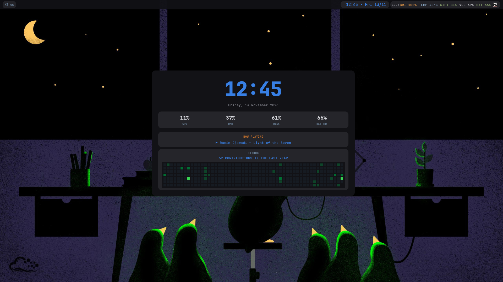

<div align="center">

# bizibiz-dots

Dark Hyprland rice: near-black surfaces, blue accent ramp, and one capsule
shape language carried through every surface — bar, launcher, power menu,
notifications, terminal prompt and desktop HUD.



</div>

## The idea

One design rule everywhere: **a dark surface, inset capsules, and blue only
for "active".** Everything you see is a variation of:

```css
surface:   rgba(18, 18, 22, 0.94)   radius 13
capsule:   rgba(216, 217, 222, 0.10) radius 12
active:    #3880e5 (blue pill)
```

The palette (see `config/kitty/theme.conf` or any file's header):

| token | hex |
|---|---|
| bg0 / bg1 / bg2 / bg3 | `#0a0a0c` `#121216` `#191920` `#26262f` |
| fg / dim | `#d8d9de` `#85868f` |
| blue / blue-dark / blue-bright | `#125bc1` `#0c3a7a` `#3880e5` |
| amber / amber-bright | `#d97a2b` `#f0a04b` |
| steel / olive | `#6b8299` `#8ba36f` |

Bar geometry is based on the V4.y capsule layout from
[atif-1402/minimal-waybar-themes](https://github.com/atif-1402/minimal-waybar-themes).

## What's inside

| Component | Config |
|---|---|
| [Hyprland](https://hyprland.org) | `config/hypr/` — keybinds, window rules, workspace-switch "woop" sound daemon |
| Waybar | `config/waybar/` — flush bar with grouped capsules, active workspace pill |
| Wofi | `config/wofi/` — app launcher, selected entry becomes the blue pill |
| wlogout | `config/wlogout/` + `assets/wlogout-icons/` — power menu |
| Dunst | `config/dunst/` — notifications, same radius, no frame lines |
| Kitty | `config/kitty/` — terminal theme |
| Eww | `config/eww/` — desktop HUD: clock, system stats, now playing, GitHub contributions calendar |
| Starship | `config/starship.toml` — powerline prompt in the same palette |
| Scripts | `bin/` — bluetooth + wifi menus, screenshot tool, clipboard history, HUD toggler, workspace sound, brightness OSD |

Extra bits worth stealing:

- `bin/ws-sound` — listens on Hyprland's event socket and plays a soft "woop"
  on every workspace switch (sound included in `sounds/`).
- `config/eww/scripts/gh-calendar.sh` — renders your GitHub contribution
  calendar (green graph) into the desktop HUD. With a GitHub token in
  `~/.config/gh-contribs-token` (classic PAT, `read:user` scope) it counts
  private contributions too; without one it shows the public numbers.
- `bin/brightness` — brightness control with a dunst progress-bar OSD.

## Install

> Tested on Hyprland 0.53, waybar, wofi, dunst 1.12, eww 0.6, kitty, wlogout,
> hyprpaper 0.8.3, hypridle/hyprlock, starship. Single 1920x1080 display.
> Fonts: JetBrains Mono + JetBrainsMono Nerd Font.

```bash
git clone https://github.com/BiziBiz-ir/bizibiz-dots.git
cd bizibiz-dots
./install.sh
```

`install.sh` copies configs into `~/.config`, scripts into `~/.local/bin`,
sounds and icons into place, and rewrites `/home/USER` in the wlogout CSS to
your home directory. Review it before running — it overwrites existing files
with the same names.

Wallpapers are **not** included (not my work) — put one in
`~/Pictures/Wallpapers/` and set it in `config/hypr/hyprpaper.conf`.

## Keybinds

| Key | Action |
|---|---|
| `SUPER+Q` / `E` / `R` | terminal / file manager / launcher |
| `SUPER+B` / `SUPER+W` | bluetooth / wi-fi menu |
| `SUPER+N` / `SUPER+SHIFT+N` | next / previous song |
| `SUPER+SPACE` / `SUPER+SHIFT+SPACE` | play-pause / stop |
| `SUPER+O` | toggle workspace-switch sound |
| `Print` / `SHIFT+Print` / `SUPER+Print` | screenshot region / full / window |
| `SUPER+SHIFT+V` | clipboard history picker |
| `SUPER+C` / `V` / `F` / `P` / `J` | kill / float / fullscreen / pseudo / split |
| `SUPER+M` / `SUPER+SHIFT+M` | power menu / exit |
| `SUPER+L` | lock |
| `SUPER+arrows` | focus, `+SHIFT` swap, `+CTRL` resize |
| `SUPER+1…0` | workspace, `+SHIFT` move window, `+ALT` move silently |
| `SUPER+TAB` / `SUPER+wheel` | previous workspace / cycle |

## License

MIT — see [LICENSE](LICENSE). The screenshot shows a wallpaper that belongs
to its artist; it is not part of this repo.
